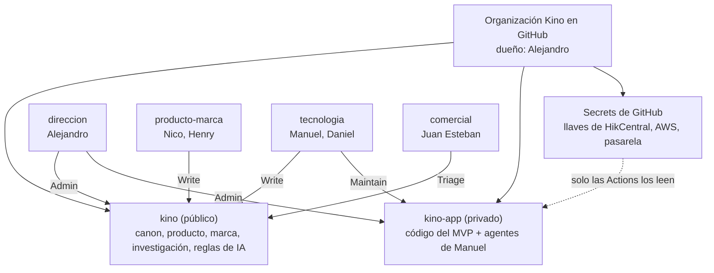
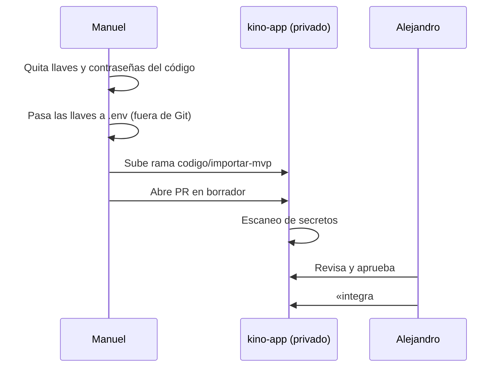

# Accesos al GitHub de Kino

Guía para unir al equipo al GitHub de Kino de forma segura. Aplica la propuesta D-015 de [`kino/canon/decisiones.md`](kino/canon/decisiones.md). Mientras D-015 esté como PROPUESTA, nadie cambia accesos: Alejandro da la orden.

## 1. Regla base

GitHub es el lugar único de Kino. Cada persona trabaja con su propia cuenta. Nadie comparte su cuenta ni su contraseña. Las credenciales nunca pasan por WhatsApp.

## 2. Estado al 11 nov 2026

| Dato | Valor | Fuente |
|---|---|---|
| Dueño del repositorio | Cuenta personal `Amonsalvem` | GitHub, lista de colaboradores |
| Visibilidad de `kino` | Público | Grok lee las reglas por `raw.githubusercontent.com` |
| Colaboradores | `Amonsalvem` (admin), `nicoraww` (write) | GitHub, lista de colaboradores |
| Código del MVP en producción | Fuera del repositorio. Lo desarrolló Manuel | D-003, «Pendiente» |
| Esquema de agentes de Manuel | Fuera del repositorio. Formato sin confirmar | Mensaje de Alejandro, 11 nov 2026 |

Una cuenta personal no tiene roles por persona: todo colaborador recibe escritura. Una organización sí tiene roles y equipos.

## 3. Esquema propuesto

| Equipo | Personas | `kino` | `kino-app` | Qué puede hacer |
|---|---|---|---|---|
| `direccion` | Alejandro | Admin | Admin | Todo. Aprueba e integra (D-003, D-008) |
| `producto-marca` | Nico, Henry | Write | Sin acceso | Abre ramas y PR. No integra a `main` |
| `tecnologia` | Manuel, Daniel | Write | Maintain | Desarrolla y despliega. Integra a `main` solo con la revisión de Alejandro |
| `comercial` | Juan Esteban | Triage | Sin acceso | Abre y ordena issues. Lee todo `kino` |

Los roles de cada persona vienen de D-007. El acceso es el mínimo para ese rol. Un acceso de más se pide con un issue.

## 4. Pasos para Alejandro

Haz cada paso solo cuando D-015 esté aprobada.

1. **Crea la organización.** En GitHub: tu foto → *Your organizations* → *New organization* → plan *Free*. Dueño: tu cuenta.
2. **Exige verificación en dos pasos.** *Settings* → *Authentication security* → *Require two-factor authentication*.
3. **Pon el rol base en «No permission».** *Settings* → *Member privileges* → *Base permissions*. Así cada acceso sale de un equipo.
4. **Transfiere `kino`.** En el repositorio: *Settings* → *Danger zone* → *Transfer*. GitHub redirige los enlaces viejos. Después, revisa que los Secrets y las Actions sigan activos.
5. **Crea los cuatro equipos** de la tabla de la sección 3 y asigna los repositorios.
6. **Invita a cada persona** con su usuario de GitHub. La invitación llega a su correo.
7. **Crea `kino-app` como privado** e invita a Manuel a subir el código y sus agentes (sección 5).
8. **Revisa la protección de `main`** en los dos repositorios: PR obligatorio y revisión de Alejandro (`.github/CODEOWNERS`).

**Costo.** El plan *Free* tiene equipos y repositorios privados. Las reglas de protección de `main` en un repositorio privado piden el plan *Team*, que se cobra por persona al mes. Verifica el precio vigente en github.com/pricing antes de decidir (sin fuente en el repositorio).

## 5. Traer el código y los agentes de Manuel

1. **Manuel describe su esquema de agentes** en un issue de `kino`: qué herramienta usa (Claude Code, Cursor u otra), qué agentes tiene y qué hace cada uno.
2. **El código va a `kino-app`, no a `kino`.** `kino` es público. El código de un sistema de control de acceso no se publica.
3. **Los agentes van con el código.** Por ejemplo `.claude/agents/` o `.cursor/rules/` en `kino-app`. El `AGENTS.md` de `kino-app` enlaza al [`AGENTS.md`](AGENTS.md) de `kino` y solo agrega lo propio del código.
4. **Antes del primer commit, Manuel limpia el código.** Ningún archivo lleva llaves, contraseñas, cédulas, teléfonos ni placas reales (`AGENTS.md` §5, regla 10). Versiona `.env.example`, nunca `.env` ([`kino/codigo/README.md`](kino/codigo/README.md)).
5. **Si una llave ya estuvo en un commit, se cambia.** Borrarla del archivo no basta: Git guarda el historial.
6. **El PR sigue las reglas de siempre:** borrador, plantilla con «Uso de IA» y aprobación de Alejandro.
7. **El curador semanal (D-013) revisa los agentes de Manuel** junto con los de Kino, cuando `kino-app` exista.

## 6. Credenciales

| Credencial | Dónde vive | Quién la ve |
|---|---|---|
| Contraseña de GitHub de cada persona | Su gestor de contraseñas | Solo esa persona |
| Llaves de HikCentral, AWS, pasarela de pagos, WhatsApp | *Secrets* de `kino-app` (*Settings* → *Secrets and variables* → *Actions*) | Las Actions. Nadie puede leer el valor después de guardarlo |
| Llaves que una persona usa en su equipo local | Archivo `.env` local, fuera de Git | Esa persona |
| Accesos compartidos que no son de GitHub (servidor, consola de AWS, HikCentral) | Gestor de contraseñas con bóveda compartida (por ejemplo Bitwarden o 1Password) | Solo el equipo que la necesita |

**Reglas.**

1. Una cuenta por persona en cada servicio. En AWS, un usuario por persona; nadie usa la cuenta raíz.
2. Una credencial nunca va por WhatsApp, correo ni un issue. Si ya pasó por ahí, se cambia.
3. Cuando alguien sale del equipo, Alejandro lo quita de la organización y se cambian las llaves que esa persona conocía.
4. Manuel tiene hoy las llaves de producción. Las pasa a los *Secrets* con Alejandro, en una llamada, sin escribirlas en el chat.

## 7. Al entrar, cada persona

1. Activa la verificación en dos pasos en su cuenta de GitHub.
2. Acepta la invitación que llega a su correo.
3. Lee [`AGENTS.md`](AGENTS.md) y [`kino/canon/proyecto.md`](kino/canon/proyecto.md).
4. Si usa IA, configura su herramienta para leer `AGENTS.md`.
5. Si quiere que se registren sus prompts, firma [`registro-ia/consentimiento.md`](registro-ia/consentimiento.md).

## 8. Mensaje para el grupo de WhatsApp

> Hola, equipo. Decidimos que todo Kino vive en GitHub: documentos, decisiones, código y agentes de IA. Así todos vemos la misma información y cada cambio queda registrado.
>
> Para entrar necesito una cosa de cada uno: su usuario de GitHub. Si no tienen cuenta, la crean gratis en github.com y activan la verificación en dos pasos.
>
> Les llega una invitación al correo. La aceptan y listo.
>
> Manu, tu código y tu esquema de agentes van a un repositorio privado. Te escribo aparte para pasarlo juntos.
>
> Importante: nadie manda contraseñas ni llaves por aquí. Las llaves van a un lugar seguro de GitHub y lo hacemos en llamada.
