# Resumen

KINO es una plataforma de control de acceso para conjuntos cerrados. Hoy opera en beta en Monte Sereno Villas Campestres, El Retiro (Antioquia). Este documento define cómo KINO pasa del piloto a un producto que se vende y se sostiene.

| Pregunta | Respuesta corta |
|---|---|
| ¿Qué resolvemos? | Quien conoce a la visita (el residente) no tiene autoridad para dejarla entrar, y quien tiene autoridad (portería) no la conoce |
| ¿A quién vendemos? | Solo a la administración del conjunto. Primero, a conjuntos campestres del oriente antioqueño con hardware HikCentral |
| ¿En qué orden crecemos? | Villas Campestres y Refugio Campestre en diciembre de 2026 y enero de 2027; 5 conjuntos nuevos del oriente antioqueño en el primer trimestre de 2027; después, el Valle de Aburrá |
| ¿Cómo cobramos? | Piso por conjunto + cobro por casa construida + implementación única + comisión por cada pago de la cuota en la app, desde el primer conjunto |
| ¿Cuándo está lista la app? | En diciembre de 2026, completa y con pagos. En enero de 2027, el 80 % de las casas de Villas y Refugio la usa |
| ¿Cuánto cobramos? | $1.550.000 por conjunto + $10.900 por casa al mes, entre el 3,3 % y el 5,9 % de la cuota de administración |
| ¿Cuánto cuesta y cuándo se sostiene? | $2,8 millones al mes en efectivo ($1,4 millones con la alternativa más barata). Villas y Refugio lo cubren desde febrero de 2027. Escenario base a diciembre de 2027: +$216 millones en efectivo |

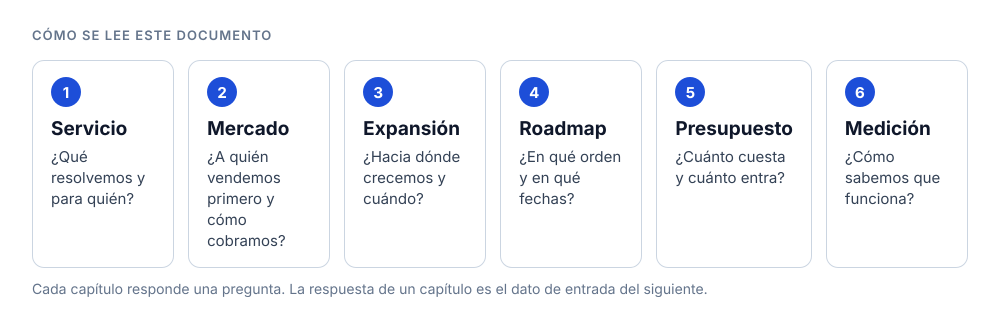{width=100%}

**Convenciones.** Las cifras están en pesos colombianos (COP). Cada dato externo lleva su fuente entre corchetes; la lista está al final. *Inferido* marca una deducción del equipo que todavía no tiene prueba.

# 1. Estrategia de servicio

> **En una frase.** KINO le da al residente la autoridad para decidir quién entra, dentro de los límites de la administración, y deja que el lector de la puerta haga cumplir esa decisión.

## 1.1 Problema

Hoy la persona que conoce a la visita (el residente) no tiene autoridad para dejarla entrar. La persona con autoridad (portería y administración) no la conoce. El ingreso se resuelve por chat, llamada y cuaderno [1] [2].

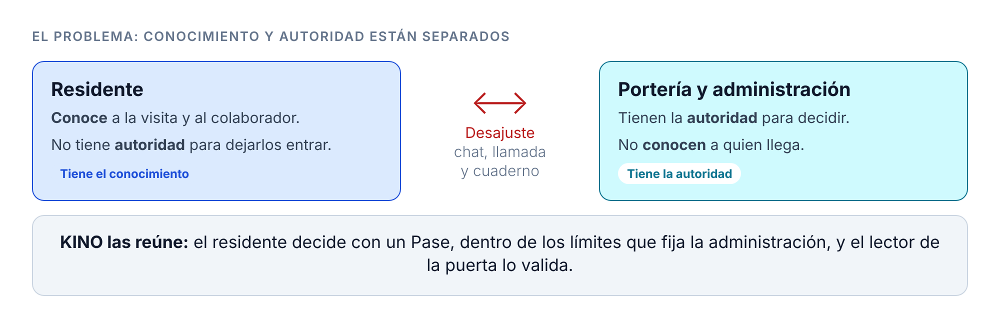{width=100%}

**Pregunta guía.** ¿Cómo reunir conocimiento y autoridad para decidir quién entra?

## 1.2 Propuesta de valor por actor

Cada actor gana algo distinto. El residente gana control; la portería, tiempo; la administración, trazabilidad.

| Actor | Hoy | Con KINO |
|---|---|---|
| Residente | Llama a portería o manda un chat | Prepara un KEY para su visita o su colaborador, dentro de los límites de la administración |
| Visita | Espera mientras portería llama a la casa | Recibe el KEY sin crear una cuenta: QR, placa o código de un solo uso |
| Colaborador (empleada, jardinero, técnico) | Entra por costumbre o por llamada, cada día | Recibe un KEY con vigencia y franja horaria. Es el ingreso más frecuente |
| Portería | Llama, anota y decide sin saber | Atiende solo las excepciones. El lector de la puerta valida el KEY |
| Administración | Da de alta personas una por una y ve poco | Fija cupos, duración y franjas. Ve autor, motivo y vigencia de cada ingreso |
| Consejo de administración | Recibe quejas sin datos | Recibe un informe: quién entró, cuándo y con autorización de quién (inferido) |

## 1.3 Diferencia frente a la competencia

La autonomía del residente no diferencia a KINO: otras plataformas, como Neivor, ya la ofrecen. KINO se diferencia en tres cosas juntas.

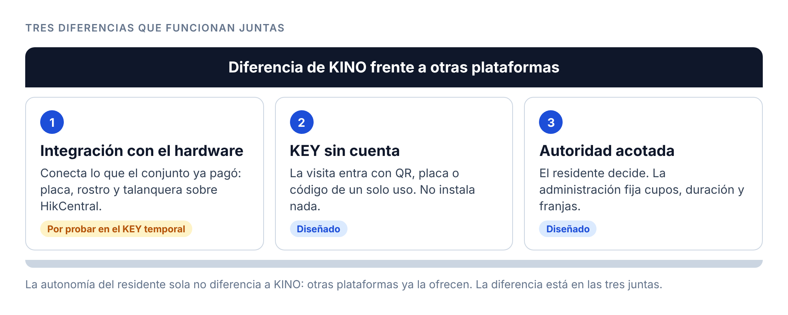{width=100%}

> **Riesgo.** La integración con el hardware todavía no está probada para el KEY temporal. Los 711 errores de sincronización del sistema actual vienen del campo de correo obligatorio [1]; la app nueva quita ese campo. Mientras esta diferencia no esté probada, KINO no la vende como un hecho.

## 1.4 Qué compra el conjunto

El conjunto no compra solo una app. Compra un servicio de tres partes, con cinco momentos de acompañamiento [4].

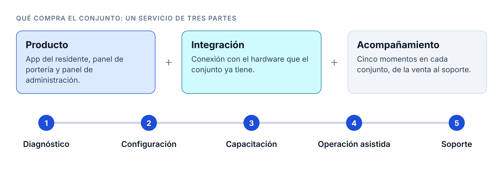{width=100%}

## 1.5 Recorrido del KEY

El recorrido muestra quién hace qué, desde que el residente abre la app hasta que la visita cruza la puerta.

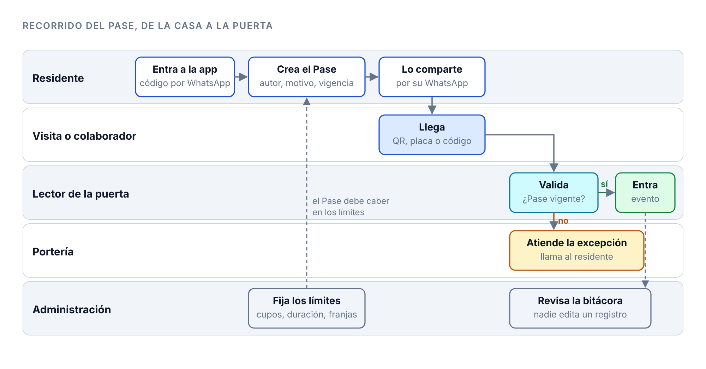{width=100%}

| Actor | Paso | Pantalla | Regla de negocio | Dato que se guarda |
|---|---|---|---|---|
| Residente | Entra a la app | Ingreso con código por WhatsApp | Teléfono obligatorio y único | Sesión, teléfono |
| Residente | Crea el KEY | Acceso previsto | Debe caber en el cupo, la duración y la franja de la administración | Autor, motivo, vigencia, modo |
| Residente | Comparte el KEY | Compartir | La visita no crea cuenta | Envío |
| Visita o colaborador | Llega a la puerta | QR, placa o código | El lector valida, no el vigilante | Evento del lector |
| Portería | Atiende la excepción | Panel de portería | Sin KEY válido, se llama al residente | Excepción manual |
| Administración | Revisa | Bitácora | Nadie edita un registro | Historial |

> **Brecha.** La app publicada hoy pide correo, contraseña o cuenta de Google. El recorrido pide código por WhatsApp. El roadmap incluye este cambio (capítulo 4).

# 2. Salida al mercado

> **En una frase.** KINO vende a la administración. Primero entra completo en Villas Campestres y Refugio Campestre, luego cierra 5 conjuntos nuevos del oriente antioqueño, y cobra por conjunto, por casa y por cada pago de la cuota.

## 2.1 Quién compra y quién decide

Solo la administración del conjunto compra KINO. En propiedad horizontal, la decisión pasa por tres instancias. La asamblea aprueba el presupuesto del conjunto. La reunión ordinaria se hace una vez al año, en los tres meses siguientes al cierre del período presupuestal [3].

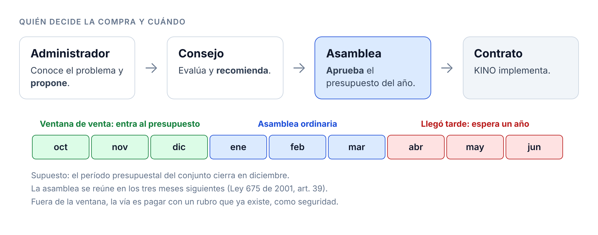{width=100%}

**Efecto en la venta (inferido).** Un conjunto que conoce KINO en noviembre puede incluirlo en su presupuesto del año siguiente. Un conjunto que lo conoce en abril espera un año, o paga con un rubro que ya existe, como seguridad.

## 2.2 Perfil del primer cliente

Hipótesis para validar con 5 administradores (inferido a partir del piloto).

| Criterio | Perfil | Por qué |
|---|---|---|
| Tipo | Conjunto campestre o parcelación | Monte Sereno es de este tipo |
| Zona | Oriente antioqueño: El Retiro, Rionegro, La Ceja, Llanogrande | Distancia corta para implementar y dar soporte |
| Hardware | Ya tiene lector de placa o de rostro sobre HikCentral | KINO conecta lo que el conjunto ya pagó |
| Dolor | Visitas y colaboradores frecuentes; portería que llama a la casa | Es el problema del diagnóstico |

## 2.3 Cabeza de playa

KINO crece de adentro hacia afuera. Cada paso usa el anterior como prueba.

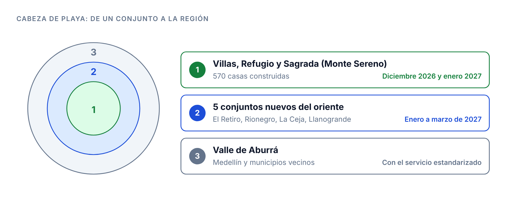{width=100%}

Villas Campestres y Refugio Campestre son el primer paso. Los dos tienen todo el hardware instalado [9]. Villas usa hoy la beta; Refugio entra como cliente nuevo. Juntos suman 500 casas construidas.

## 2.4 Penetración en Villas y Refugio

Cerrar el negocio con la administración no basta: el valor aparece cuando los residentes usan la app. Esta sección dice cómo KINO llega rápido a las casas, desde que la app está lista en diciembre.

> **Meta.** El 80 % de las casas construidas con un residente activo al 31 de enero de 2027: 80 casas en Villas y 320 en Refugio, 400 de 500.

**Residente activo (propuesta).** Un residente que en los últimos 30 días entró a la app y creó un KEY o pagó la cuota.

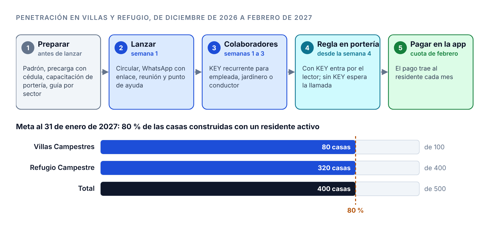{width=100%}

| Paso | Qué se hace | Quién | Cómo se mide |
|---|---|---|---|
| 1 · Preparar (antes de que la app esté lista) | La administración entrega el padrón de casas y residentes. KINO precarga a cada residente y lo valida contra su cédula. Portería recibe capacitación. Cada sector tiene un residente guía | Administración, KINO, portería | Casas precargadas ÷ casas construidas |
| 2 · Lanzar (semana 1) | Circular de la administración y mensaje por WhatsApp con el enlace. El residente entra con el código de WhatsApp, sin registrarse. Reunión de presentación y punto de ayuda en portería | Administración, consejo, KINO | Casas con primer ingreso ÷ casas construidas |
| 3 · Activar colaboradores (semanas 1 a 3) | Cada casa crea un KEY recurrente para su empleada, jardinero o conductor. Es el ingreso de todos los días: un KEY ahorra una llamada diaria | Residentes, guías | KEYs de colaborador por casa |
| 4 · Cambiar la regla en portería (desde la semana 4) | La visita con KEY entra por el lector. La visita sin KEY espera la llamada a la casa. Portería atiende la excepción, no la regla | Administración, portería | Ingresos con KEY ÷ ingresos totales |
| 5 · Pagar en la app (cuota de febrero) | La administración invita a pagar la cuota en la app. El pago mensual hace que el residente vuelva cada mes (inferido) | Administración | Casas que pagan en la app ÷ casas construidas |
| Todos los días | Tablero de casas activas por sector. El guía llama a las casas que faltan | KINO, guías | Casas activas ÷ casas construidas |

**Por qué este orden (inferido).** El residente adopta lo que le ahorra trabajo cada día. Por eso el colaborador va antes que la visita ocasional, y el cambio de regla en portería llega cuando la mayoría ya tiene la app.

**Riesgos.** Fin de año: muchos residentes viajan o reciben visitas. Segundas viviendas: en un conjunto campestre, parte de las casas no se ocupa todo el mes, y la meta del 80 % puede ser alta. Padrón incompleto: sin teléfono y cédula de cada residente, la precarga falla. Portería: si no aplica la regla del paso 4, el residente no ve razón para cambiar.

## 2.5 Canales de adquisición

| Canal | Cómo funciona | Costo | Estado |
|---|---|---|---|
| Referido de administradores | Un administrador lleva varias copropiedades y recomienda a otros | Bajo | Inferido; validar en entrevistas |
| Instaladores de HikCentral | El instalador vende el hardware; KINO le da el software que lo hace útil | Comisión por definir | Inferido; sin alianza firmada |
| Caso del piloto | Informe con datos medidos de Villas y Refugio | Bajo | Depende del hito H3 (febrero de 2027) |
| soykino.com y redes | Pedido de demostración | Bajo | Sitio en línea |
| Eventos de propiedad horizontal | Charlas a administradores | Medio | Sin contacto |

## 2.6 Embudo de venta

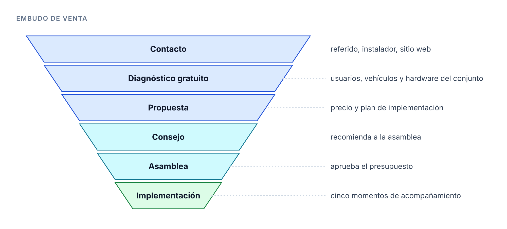{width=100%}

El diagnóstico gratuito también vende: muestra al conjunto su propio problema con datos (inferido).

## 2.7 Modelos de ingreso evaluados

El equipo evaluó seis formas de cobrar. La figura 10 las ubica por rentabilidad y riesgo.

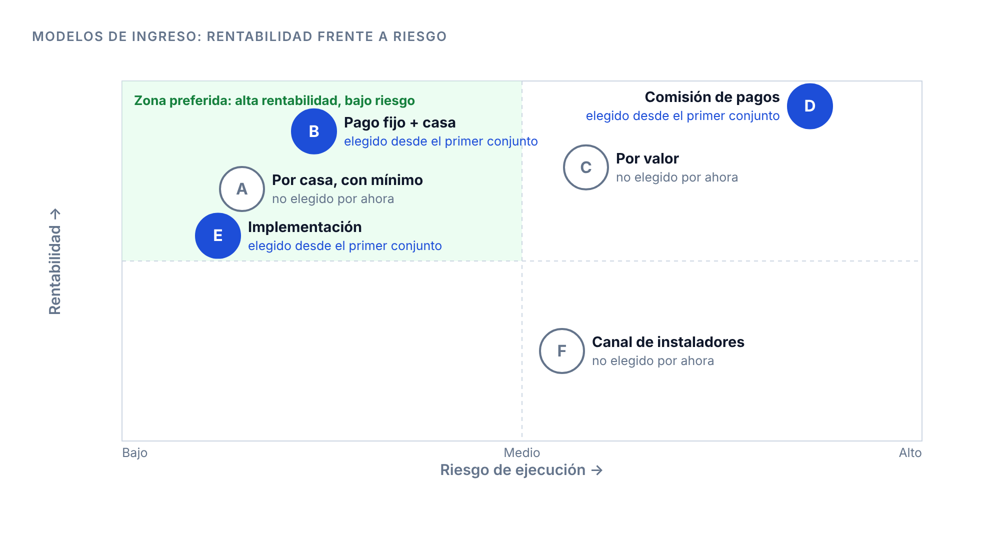{width=100%}

| Modelo | Cómo cobra | Rentabilidad | Riesgo |
|---|---|---|---|
| A · Por casa | Una tarifa por casa construida | Media: un conjunto pequeño casi no paga | Bajo |
| **B · Piso + casa** | Una tarifa fija por conjunto más una tarifa por casa | Alta: el piso cubre el soporte de cada conjunto | Bajo |
| C · Por valor | Una fracción del costo de un puesto de vigilancia | Alta | Medio: exige probar el ahorro en portería |
| **D · Comisión de pagos** | Margen sobre la pasarela cuando el residente paga la cuota de administración en la app | La más alta a escala: crece sin trabajo extra | Alto: exige alianza con la pasarela y el módulo de pagos |
| **E · Implementación** | Cobro único al empezar | Media: da caja al inicio y filtra clientes | Bajo |
| F · Canal de instaladores | Comisión por hardware o reventa de KINO | Baja en ingreso, alta en adquisición | Medio |

Para el modelo D, la pasarela Wompi cobra 2,65 % + $700 + IVA en pagos en línea y 1 % + IVA en pagos con QR [16].

**Descartados.** Cobrar a la visita (recibe el KEY sin cuenta). Cobrar al residente (solo compra la administración). Marca blanca (KINO mantiene su marca). Vender datos de ingresos (Ley 1581 de 2012 [17]).

> **Modelo elegido.** B + D + E desde el primer conjunto.

**Costo marginal.** Una casa más casi no sube el costo de KINO: la infraestructura y el trabajo son fijos (capítulo 5). Después del punto de equilibrio, cada peso nuevo es margen (inferido).

## 2.8 Cómo funciona el cobro de pagos (modelo D)

El residente paga la cuota de administración desde la app. El dinero va a la cuenta del conjunto. KINO cobra un margen por cada pago.

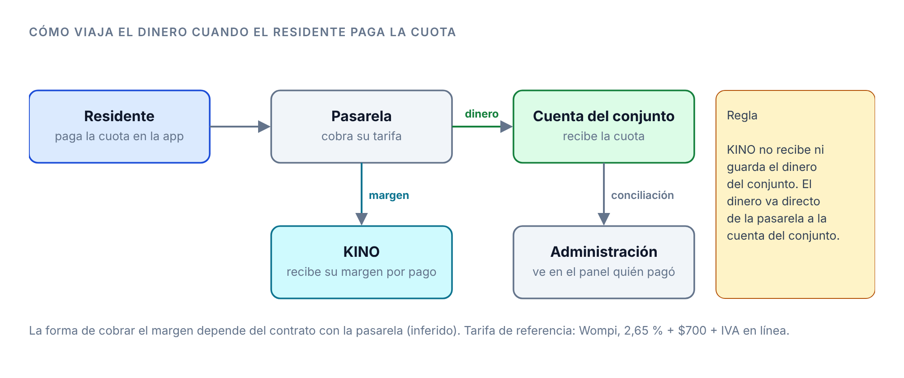{width=100%}

| Pregunta | Respuesta |
|---|---|
| ¿Qué paga el residente? | La cuota de administración. Después, otros cobros del conjunto, como reservas o multas |
| ¿Quién recibe el dinero? | El conjunto, en su propia cuenta. KINO no recibe ni guarda el dinero del conjunto |
| ¿Cómo gana KINO? | Un margen por cada pago. Hay dos formas de cobrarlo, según el contrato con la pasarela: un acuerdo con la pasarela sobre su tarifa, o un cargo de KINO por pago procesado en la factura mensual del conjunto (inferido) |
| ¿Cuánto cobra la pasarela? | Wompi cobra 2,65 % + $700 + IVA en pagos en línea y 1 % + IVA en pagos con QR [16] |
| ¿Quién asume la tarifa? | Por decidir: el conjunto o el residente |
| ¿Qué gana el conjunto? | Ve en el panel quién pagó, sin cruzar extractos. El residente recibe su recibo digital. Menos tiempo de la administración en cobros (inferido) |
| ¿Qué se necesita antes de cobrar? | Contrato con la pasarela, cuenta del conjunto vinculada, política de datos (Ley 1581 de 2012 [17]) y el módulo de pagos en la app de diciembre |

**Ingreso del modelo D.** Casas que pagan en la app × margen por pago, cada mes. El cálculo con cifras va en el capítulo 5, con la cuota de administración de Villas y Refugio.

**Por qué ayuda a la penetración (inferido).** El KEY se usa cuando llega alguien; la cuota se paga todos los meses. El pago lleva al residente a la app cada mes.

## 2.9 Precio

> **Precio.** $1.550.000 al mes por conjunto + $10.900 al mes por casa construida + $3.200.000 de implementación, una vez + $2.000 por cada pago de la cuota en la app (margen por decidir).

El precio se justifica con tres referencias:

| Referencia | Qué dice | Dato |
|---|---|---|
| Piso | Lo que cuesta atender a los conjuntos | $2,8 millones al mes en efectivo; $6,4 millones con el trabajo de los socios (capítulo 5) |
| Techo | Lo que el residente ya paga y lo que el conjunto gasta en portería | Cuota de administración promedio de Villas y Refugio: $450.000 al mes por casa [9]. Un puesto de vigilancia 24 horas: $17,1 a $19,6 millones al mes [10] [11] |
| Ancla | El precio de su competidor directo, Unita | $1.550.000 al mes por conjunto + $10.900 al mes por casa [5] |

KINO cobra lo mismo que Unita en piso y casa, y agrega lo que Unita no tiene: el KEY sin cuenta para la visita y la integración probada con el hardware del conjunto (apartado 1.3).

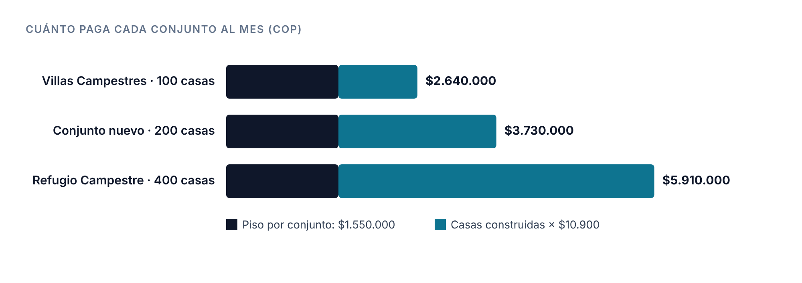{width=100%}

**Cuánto pesa KINO en la cuota.** Con una cuota de $450.000, KINO cuesta entre el 3,3 % y el 5,9 % de lo que paga cada casa. En lo que recauda cada conjunto, un puesto de vigilancia pesa entre el 9,5 % (Refugio) y el 44 % (Villas) (figura 14).

| Conjunto | KINO al mes | KINO por casa | Parte de la cuota de $450.000 |
|---|---|---|---|
| Villas Campestres (100 casas) | $2.640.000 | $26.400 | 5,9 % |
| Conjunto nuevo (200 casas, supuesto) | $3.730.000 | $18.650 | 4,1 % |
| Refugio Campestre (400 casas) | $5.910.000 | $14.775 | 3,3 % |

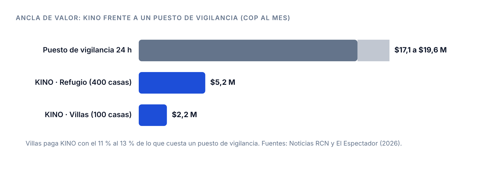{width=100%}

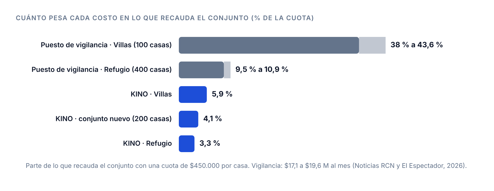{width=100%}

**Margen por pago (supuesto, por decidir).** $2.000 por pago es el 0,44 % de la cuota. Es menos que la tarifa de la pasarela: con Wompi, un pago de $450.000 cuesta cerca de $15.024 en línea y $5.355 con QR, con IVA [16]. Quién asume la tarifa de la pasarela sigue por decidir (apartado 2.8).

**Lectura (inferido).**

1. El cobro por casa ($10.900) es el 2,4 % de la cuota. Es un costo bajo frente a lo que la casa ya paga en vigilancia.
2. En un conjunto pequeño, el piso pesa más: Villas paga el 5,9 % de la cuota y Refugio el 3,3 %. Un piso más bajo para conjuntos de menos de 150 casas es una opción que se valida en la fase 6.
3. El costo de portería propio de Villas y Refugio todavía no está. Cuando llegue, reemplaza la cifra de mercado del techo.

# 3. Expansión

> **En una frase.** En 2027 KINO crece en dos ejes: más conjuntos (eje X) y más módulos y productos (eje Y). Cada paso tiene una condición que se cumple antes de empezar.

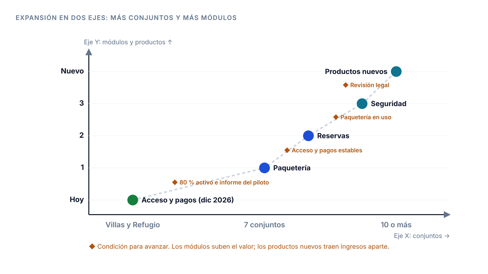{width=100%}

**Eje X: conjuntos.** Villas y Refugio, luego 5 conjuntos nuevos en el primer trimestre de 2027, luego 10 o más.

**Eje Y: módulos y productos.** Los módulos suben el valor de la app y justifican un precio mayor; no son una línea de ingreso aparte. Los productos nuevos sí venden algo distinto. Orden de los módulos:

| Orden | Módulo | Qué hace |
|---|---|---|
| Hoy | Acceso y pagos | KEY para visitas y colaboradores; pago de la cuota en la app (diciembre de 2026) |
| 1 | Paquetería | Portería registra el paquete y el residente recibe el aviso |
| 2 | Reservas | El residente reserva zonas comunes desde la app |
| 3 | Seguridad | Botón de alerta a portería, registro de rondas, alertas de las cámaras e informe mensual para el consejo |

| Paso | Condición para empezar |
|---|---|
| De Villas y Refugio a 5 conjuntos nuevos | 80 % de las casas activas (H2) e informe del piloto (H3) |
| De 7 a 10 o más conjuntos | Precio probado y costo de implementación medido en los 5 conjuntos nuevos |
| Paquetería | Acceso y pagos estables: errores de sincronización por debajo de un umbral por fijar |
| Reservas | Paquetería en uso |
| Seguridad | Revisión legal de cámaras y datos personales |

Fuentes de las etapas y condiciones: [4] [5] [6].

**Marca.** KINO mantiene su marca propia en todos los conjuntos. El nombre del conjunto aparece solo como dato, nunca con su logo ni sus colores.

# 4. Roadmap

> **En una frase.** En diciembre de 2026 la app queda completa; en enero de 2027 Villas y Refugio llegan al 80 %; de enero a marzo KINO cierra 5 conjuntos nuevos; el resto de 2027 suma módulos.

## 4.1 Fases

| Fase | Objetivo | Fechas | Estado a noviembre de 2026 |
|---|---|---|---|
| 0 · Descubrimiento | Entender el problema, los actores y el hardware | Hasta septiembre de 2026 | Hecha |
| 1 · Marca e identidad | Construir una identidad propia | Hasta noviembre de 2026 | Hecha |
| 2 · Diseño y prototipo | Prototipo de los 3 roles: 172 pantallas, app y web | Hasta noviembre de 2026 | Hecha |
| 3 · Desarrollo | App completa: ingreso por WhatsApp, KEY temporal, KEY de colaborador, registro con cédula y pagos | Noviembre y diciembre de 2026 | En curso |
| 4 · Piloto | Implementar y penetrar Villas y Refugio | Diciembre de 2026 y enero de 2027 | Por hacer |
| 5 · Venta | Cerrar e implementar 5 conjuntos nuevos | Enero a marzo de 2027 | Por hacer |
| 6 · Precio | Justificar el precio y validarlo con administradores | Noviembre de 2026 a enero de 2027 | En curso |
| 7 · Lanzamiento | Caso del piloto, sitio, video y redes | Febrero de 2027 | Sitio soykino.com en línea |
| 8 · Eje Y | Paquetería, reservas y seguridad; productos nuevos | Abril a diciembre de 2027 | Por hacer |
| 9 · Legal | Política de datos, contrato tipo y contrato con la pasarela | Antes de diciembre de 2026 | Registro de marca radicado |

> **Qué es el piloto.** Una prueba en operación real, con alcance limitado y un tiempo fijo. Sirve para medir antes de vender a más clientes. En KINO, el piloto es Villas y Refugio en diciembre y enero. Mide cuántas casas usan la app, cuánto baja el tiempo en portería y cuántos ingresos pasan con KEY. Su resultado es el informe del piloto (H3), el principal argumento para vender los 5 conjuntos nuevos.

## 4.2 Cronograma

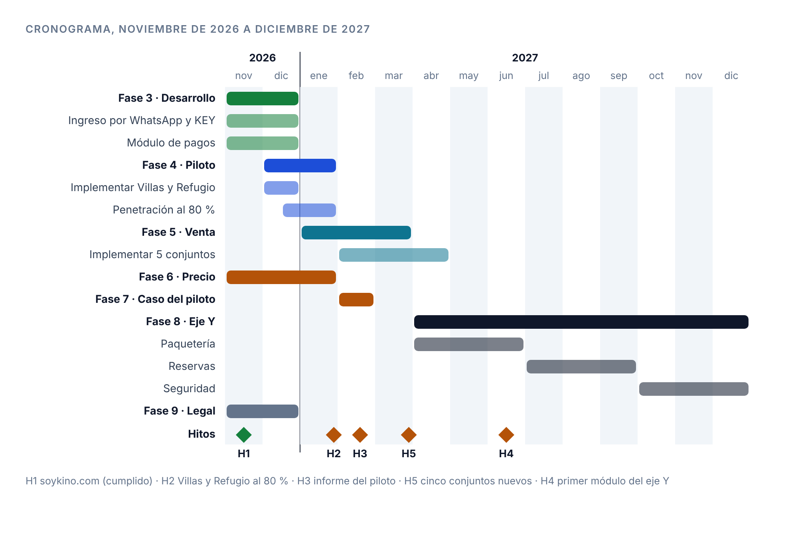{width=100%}

| Hito | Fecha | Se cumple cuando | Estado |
|---|---|---|---|
| H1 · soykino.com | nov 2026 | Sitio en línea con HTTPS y correo | Cumplido |
| H2 · Villas y Refugio penetrados | ene 2027 | App completa en producción desde diciembre y 80 % de las casas con un residente activo | Por cumplir |
| H3 · Informe del piloto | feb 2027 | Resultados de diciembre y enero medidos y publicados | Por cumplir |
| H4 · Primer módulo del eje Y | jun 2027 (propuesta) | Paquetería en uso en al menos un conjunto | Por cumplir |
| H5 · Cinco conjuntos nuevos | ene a mar 2027 | 5 contratos firmados al 31 de marzo de 2027. En desarrollo desde enero | Por cumplir |

Fechas fijadas por el equipo el 9 de noviembre de 2026 [9]. La fecha de H4 es una propuesta.

## 4.3 Tareas clave y responsables

| Tarea | Por qué | Responsable |
|---|---|---|
| Ingreso con código por WhatsApp | La app publicada pide correo y contraseña | Alejandro, Manuel |
| Quitar el correo obligatorio | Causa los 711 errores de sincronización [1] | Alejandro, Daniel |
| KEY temporal con evento del lector | Sin esto no se prueba la diferencia | Alejandro, Daniel |
| KEY de colaborador con franja | Es el ingreso más frecuente | Alejandro |
| Registro validado contra la cédula | El administrador ya no aprueba registros | Alejandro |
| Implementar Refugio Campestre | Cliente nuevo con el hardware instalado | Daniel, Manuel |
| Módulo de pagos y contrato con la pasarela | El modelo D empieza en diciembre | Alejandro, Manuel |
| Padrón, precarga y plan de penetración de Villas y Refugio | Meta del 80 % en enero | Juan Esteban, Nicolás |
| Venta a 5 conjuntos nuevos | Hito H5 | Juan Esteban |
| Actualizar la versión de MySQL | Ahorra USD 144 al mes, el 41 % del costo de AWS (capítulo 5) | Alejandro, Manuel |
| Entrevistas a administradores | Validar perfil, canales y precio | Juan Esteban, Nicolás |
| Caso del piloto y contenido | Canal de adquisición | Henry, Nicolás |

**Equipo.** Nicolás Ramírez (marca y estrategia), Alejandro Monsalve (técnica y lógica), Juan Esteban (comercial), Manuel (tecnología), Daniel (IoT) y Henry (marca). Todos son socios.

# 5. Presupuesto

> **En una frase.** KINO cuesta $2,8 millones al mes en efectivo. Villas y Refugio cubren ese costo desde febrero de 2027. Con los 5 conjuntos nuevos, el escenario base cierra diciembre de 2027 con +$216 millones en efectivo. Una alternativa más barata baja el costo a $1,4 millones al mes.

Horizonte: noviembre de 2026 a diciembre de 2027 (14 meses). Fuente de dinero: capital propio de los socios [9].

**Dos vistas.** La vista *en efectivo* suma lo que KINO paga. La vista *de sostenimiento* suma también el trabajo de los socios, valorado aunque hoy nadie cobra [8] [9]. La primera vista dice si alcanza la caja; la segunda dice si el negocio paga el tiempo de quienes lo hacen.

**Supuestos**

| Supuesto | Valor | Fuente |
|---|---|---|
| Tasa de cambio | $3.300 por USD: techo del rango previsto para noviembre de 2026. TRM del 4 de noviembre: $3.235,59 | [12] [13] |
| Equipo | Nadie cobra; todos son socios | [9] |
| Unidades | Villas Campestres: 100 casas construidas. Refugio Campestre: 400 casas construidas | [9] |
| Conjunto nuevo | 200 casas construidas (supuesto) | |
| Cuota de administración | $450.000 al mes por casa, promedio de Villas y Refugio | [9] |
| Calendario | Refugio se implementa en diciembre de 2026. Villas y Refugio pagan desde febrero de 2027, después de H2. Los 5 conjuntos nuevos firman en el primer trimestre y se implementan uno por mes (supuesto) | [9] |
| Pagos en la app | Parte de las casas que paga la cuota en la app: 30 %, 50 % o 80 % según el escenario (supuesto) | |
| Margen por pago | $2.000 (supuesto, por decidir) | Apartado 2.9 |
| Reserva para imprevistos | 15 % | [8] |

## 5.1 Inversión ya hecha

| Rubro | Valor |
|---|---|
| Registro de marca, una clase | $1.200.000 [9] |

## 5.2 Infraestructura (AWS)

| Componente | USD al mes | COP al mes |
|---|---|---|
| Servidores, discos, base de datos, balanceadores, integración y red | 147,56 | 486.948 |
| Soporte extendido de MySQL 8 | 144,00 | 475.200 |
| Almacenamiento, respaldos, registros y transferencia | 58,44 | 192.852 |
| **Total AWS** | **350,00** | **1.155.000** |

Fuente: [8]. Incluye producción y pruebas. El costo de AWS con 7 conjuntos no está estimado; aquí se mantiene fijo.

## 5.3 Herramientas y trabajo

| Rubro | COP al mes | En efectivo | Fuente |
|---|---|---|---|
| Claude Team: 1 puesto Premium (Alejandro) y 1 estándar (Nicolás), pago mensual (USD 125 + 25) | 495.000 | Sí | [9] [14] |
| Grok Premium, 1 cuenta (Nicolás) (USD 30) | 99.000 | Sí | [9] [19] |
| Figma Enterprise, 2 puestos Full (Alejandro y Nicolás), USD 90 cada uno con pago anual | 594.000 | Sí | [9] [15] |
| Hospedaje de la página web (USD 20) | 66.000 | Sí | [9] |
| Mensajes de WhatsApp para el ingreso (≈ USD 3) | 9.900 | Sí | [18] |
| Soporte funcional: 20 h × $60.000 | 1.200.000 | No, socios | [8] |
| Mantenimiento técnico e integración: 16 h × $100.000 | 1.600.000 | No, socios | [8] |
| Coordinación y seguimiento: 4 h × $80.000 | 320.000 | No, socios | [8] |

**Figma Enterprise** se paga por año: USD 2.160 de una vez, unos $7,1 millones. La tabla lo muestra como cuota mensual.

**WhatsApp (inferido).** 1.500 casas × 2 ingresos a la app al mes = 3.000 mensajes. A USD 0,001 por mensaje, son USD 3 al mes. El residente comparte el KEY desde su propio WhatsApp; ese envío no le cuesta a KINO.

**Capacidad.** 40 horas al mes, en horario hábil, sin atención 24 horas [8]. Cada implementación pide 40 horas más [8]. Con un conjunto nuevo por mes de abril a agosto, el equipo necesita 80 horas en esos meses (inferido). Es el mayor riesgo del calendario.

## 5.4 Costo mensual

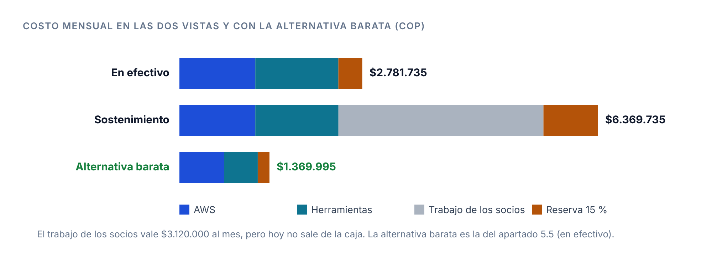{width=100%}

| Rubro | En efectivo | Sostenimiento |
|---|---|---|
| AWS | 1.155.000 | 1.155.000 |
| Herramientas y WhatsApp | 1.263.900 | 1.263.900 |
| Trabajo de los socios (valorado) | 0 | 3.120.000 |
| Subtotal | 2.418.900 | 5.538.900 |
| Reserva 15 % | 362.835 | 830.835 |
| **Total al mes** | **2.781.735** | **6.369.735** |

## 5.5 Alternativa más barata

Cinco cambios bajan el costo en efectivo a la mitad sin quitarle al proyecto nada que use hoy (inferido). Precios de pago anual [14] [15].

| Rubro | Hoy (USD al mes) | Alternativa (USD al mes) | Qué se pierde |
|---|---|---|---|
| Claude Team | 150, pago mensual | 120, pago anual (100 + 20) | Compromiso de 12 meses |
| Figma | 180, Enterprise, 2 puestos Full | 32, Professional, 2 puestos Full (16 cada uno) | Inicio de sesión único, administración avanzada y analítica de bibliotecas. Un equipo de 2 personas no las usa (inferido) |
| Grok | 30 | 0: Nicolás trabaja con su puesto de Claude Team | El flujo de Nicolás con Grok. Lo decide Nicolás |
| Soporte extendido de MySQL en AWS | 144 | 0: actualizar la base de datos a una versión con soporte estándar | Una migración con pruebas, a cargo de Alejandro |
| Hospedaje de la página web | 20 | 0: plan gratuito para sitios estáticos (inferido: confirmar que la página es estática) | Nada, si la página es estática |
| **Total con AWS y WhatsApp** | **733** | **361** | |

| Vista | Hoy | Alternativa | Ahorro al mes | Ahorro en 14 meses |
|---|---|---|---|---|
| En efectivo, con reserva | 2.781.735 | 1.369.995 | 1.411.740 (51 %) | 19.764.360 |

**Recomendación.** Aplicar los cinco cambios. El de Grok depende de Nicolás; sin ese cambio, el costo en efectivo queda en $1.483.845 al mes.

## 5.6 Costo total a diciembre de 2027

| Vista | 14 meses | Marca | Implementaciones (horas de los socios) | **Total** |
|---|---|---|---|---|
| En efectivo | 38.944.290 | 1.200.000 | 0 | **40.144.290** |
| Sostenimiento, escenario base | 89.176.290 | 1.200.000 | 6 × 3.200.000 | **109.576.290** |
| En efectivo, con la alternativa | 19.179.930 | 1.200.000 | 0 | **20.379.930** |

## 5.7 Ingresos

Precio del apartado 2.9. Villas Campestres no paga implementación porque ya está implementada. Con el 50 % de las casas pagando en la app:

| Conjunto | Piso + casas | Comisión de pagos | Al mes |
|---|---|---|---|
| Villas Campestres (100 casas) | 2.640.000 | 50 × 2.000 = 100.000 | 2.740.000 |
| Refugio Campestre (400 casas) | 5.910.000 | 200 × 2.000 = 400.000 | 6.310.000 |
| Conjunto nuevo (200 casas) | 3.730.000 | 100 × 2.000 = 200.000 | 3.930.000 |

Los escenarios cambian cuántos conjuntos nuevos entran, desde cuándo y cuántas casas pagan en la app. El precio es el mismo.

| Escenario | Conjuntos nuevos | Pagos en la app | Comisión a dic 2027 | Ingreso a dic 2027 |
|---|---|---|---|---|
| Conservador | 2, en julio y septiembre de 2027 | 30 % | 4.500.000 | 145.450.000 |
| **Base** | **5, uno por mes de abril a agosto de 2027** | **50 %** | **12.500.000** | **256.300.000** |
| Optimista | 5, uno por mes de marzo a julio de 2027 | 80 % | 21.600.000 | 284.050.000 |

Los tres escenarios incluyen a Villas y Refugio desde febrero de 2027 y una implementación de $3.200.000 por cada conjunto nuevo y por Refugio.

## 5.8 Resultado a diciembre de 2027

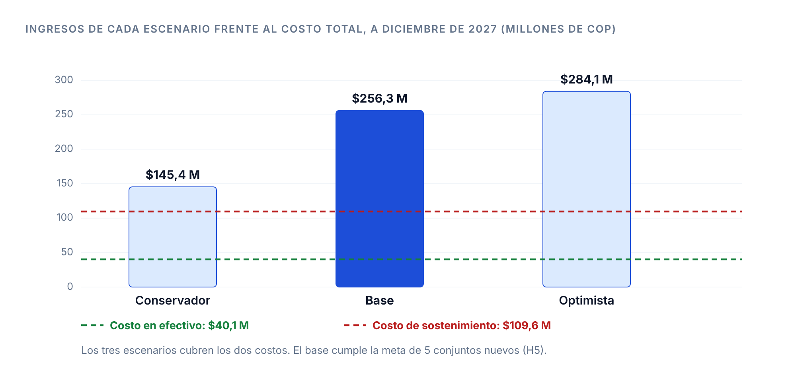{width=100%}

| Escenario | Ingresos | En efectivo | Sostenimiento |
|---|---|---|---|
| Conservador | 145.450.000 | +105.305.710 | +45.473.710 |
| **Base** | **256.300.000** | **+216.155.710** | **+146.723.710** |
| Optimista | 284.050.000 | +243.905.710 | +174.473.710 |

Sin impuestos. Con la alternativa más barata, el escenario base sube a +$235,9 millones en efectivo.

**Cuánto capital ponen los socios.** La figura 19 muestra el acumulado del escenario base mes a mes. La caja toca su punto más bajo en enero de 2027: −$6,3 millones, que pagan los socios con capital propio. Desde marzo de 2027 la caja queda en positivo. El sostenimiento llega a −$20,3 millones en enero y queda en positivo desde mayo de 2027.

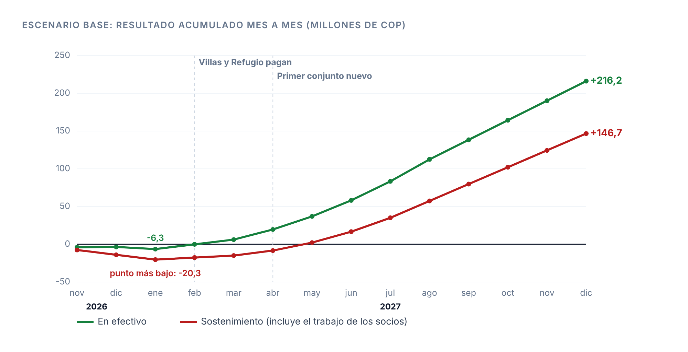{width=100%}

| Tramo | Ingreso al mes | Qué pasa |
|---|---|---|
| nov 2026 a ene 2027 | 0, más la implementación de Refugio en diciembre | Desarrollo y piloto. La caja baja a −$6,3 millones |
| feb y mar 2027 | 9.050.000 (Villas + Refugio) | La caja se recupera |
| abr a ago 2027 | De 12.980.000 a 28.700.000 | Entra un conjunto nuevo cada mes |
| sep a dic 2027 | 28.700.000 | Siete conjuntos pagan |

Si Figma Enterprise se paga por adelantado, la caja necesita unos $7,1 millones más al inicio.

## 5.9 Punto de equilibrio mensual

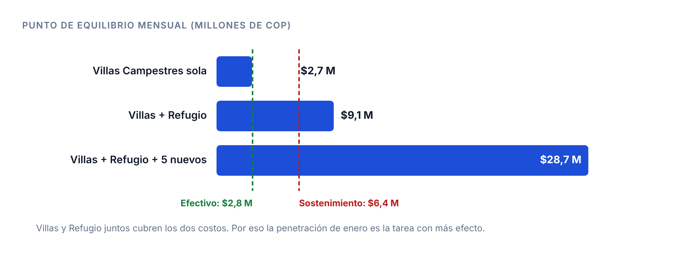{width=100%}

| Conjuntos que pagan | Ingreso al mes | Cubre el efectivo (2.781.735) | Cubre el sostenimiento (6.369.735) |
|---|---|---|---|
| Villas Campestres sola | 2.740.000 | No: 98 % | 43 % |
| Villas + Refugio | 9.050.000 | Sí | Sí, con +2.680.265 |
| Villas + Refugio + 5 nuevos | 28.700.000 | Sí | Sí, con +22.330.265 |

**Lectura (inferido).**

1. Con las herramientas actuales, Villas sola ya no cubre la caja. Con la alternativa más barata ($1,4 millones), sí.
2. Villas y Refugio juntos cubren el sostenimiento completo desde febrero de 2027. Por eso la penetración de enero (apartado 2.4) es la tarea con más efecto en el presupuesto.
3. La comisión de pagos suma $12,5 millones en el escenario base, el 5 % del ingreso. Su valor está en que el residente vuelve a la app cada mes, no en el ingreso.
4. El riesgo mayor es la capacidad: implementar 5 conjuntos entre abril y agosto pide el doble de horas de hoy.

## 5.10 Fuera del presupuesto

| Rubro | Motivo |
|---|---|
| Hardware HikCentral | Ya instalado en Villas y Refugio; lo pagó Monte Sereno [9] |
| Desplazamientos | No se incluyen [9] |
| Equipos, licencias, red y energía de cada conjunto | Sin responsable confirmado [8] |
| Crecimiento de AWS con 7 conjuntos | Sin estimar |
| Funciones nuevas y módulos del eje Y | Sin estimar [8] |
| Tarifa de la pasarela | La asume el conjunto o el residente, por decidir |
| Atención 24 horas | Fuera de la capacidad de 40 horas [8] |
| Abogado: política de datos y contrato tipo | Sin cotización |
| Impuestos | Sin dato [8] |
| Costo de portería de Villas y Refugio | Por recibir; reemplaza la cifra de mercado del apartado 2.9 |

# 6. Medición

> **En una frase.** Los indicadores siguen una cadena: la marca trae conjuntos, el piloto prueba el valor, la técnica lo sostiene y el negocio lo cobra.

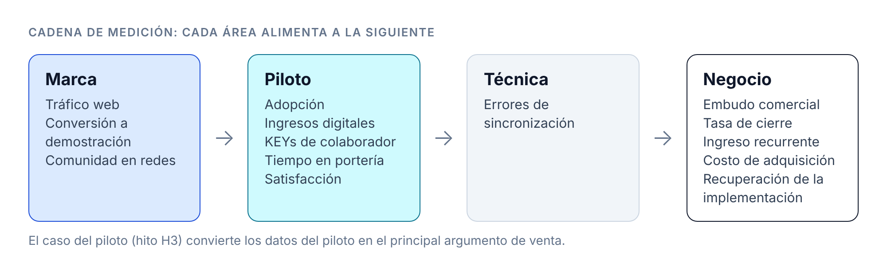{width=100%}

No hay líneas base todavía. Cada indicador dice cómo se mide y una meta inicial propuesta, que se ajusta con la primera medición [5].

| Área | Indicador | Fórmula | Meta inicial |
|---|---|---|---|
| Marca | Tráfico web | Usuarios únicos en soykino.com | 200 en 90 días |
| Marca | Conversión a demostración | Solicitudes ÷ usuarios únicos | 3 % en 90 días |
| Marca | Comunidad en redes | Seguidores y publicaciones al mes | 150 seguidores y 4 publicaciones al mes a 90 días |
| Piloto | Adopción | Casas con un residente activo ÷ casas construidas | 80 % al 31 de enero de 2027 |
| Piloto | Pagos en la app | Casas que pagan la cuota en la app ÷ casas construidas | Línea base con la cuota de febrero de 2027 |
| Piloto | Ingresos digitales | Se reporta en tres cifras: placas sincronizadas, excepciones manuales y KEYs confirmados por el lector | Línea base en el mes 1 |
| Piloto | KEYs de colaborador | KEYs de colaborador ÷ KEYs emitidos | Línea base en el mes 1 |
| Piloto | Tiempo en portería | Mediana entre la llegada y el registro de entrada | ≤ 45 segundos |
| Piloto | Satisfacción | NPS de residentes; CSAT de portería y administración (1 a 5) | NPS ≥ 30; CSAT ≥ 4,0 |
| Técnica | Errores de sincronización | Errores por semana | Umbral para pasar a la etapa 02 |
| Negocio | Embudo comercial | Conjuntos contactados, propuestas y contratos | 5 contratos firmados al 31 de marzo de 2027 |
| Negocio | Tasa de cierre | Propuestas aceptadas ÷ enviadas | Revisar al llegar a 5 propuestas |
| Negocio | Ingreso recurrente mensual | Σ (piso + casas × cobro por casa) | $9,05 millones con Villas + Refugio; $28,7 millones con 7 conjuntos |
| Negocio | Costo de adquisición | Gasto comercial ÷ conjuntos firmados | Línea base con el primer cierre |
| Negocio | Recuperación de la implementación | Costo de implementación ÷ margen mensual del conjunto | Línea base con Refugio |

# Fuentes

1. Equipo KINO. Inspección directa del sistema de control de acceso de Monte Sereno (panel de administración y HikCentral). Septiembre de 2026.
2. Equipo KINO. Entrevistas a 5 residentes de Monte Sereno. 2 de septiembre de 2026.
3. Congreso de Colombia. Ley 675 de 2001, régimen de propiedad horizontal, artículos 38 y 39. http://www.secretariasenado.gov.co/senado/basedoc/ley_0675_2001.html
4. KINO. *Productos y servicios v2*, documento comercial. 3 de noviembre de 2026.
5. KINO. *El camino de KINO*, presentación de estrategia (Figma Slides), láminas 7 a 34. Octubre de 2026. Incluye la tarifa de referencia del competidor (lámina 32) y los indicadores SMART.
6. KINO. *Plan operativo EMP-002, Gantt*. 28 de octubre de 2026.
7. KINO. *Estrategia de servicio* (Figma Slides), 21 láminas. Noviembre de 2026.
8. KINO. *Presupuesto mensual: infraestructura y operación*. 8 de noviembre de 2026.
9. Equipo KINO. Datos de operación y metas: unidades por conjunto, hardware instalado, cuota de administración promedio, herramientas y puestos en uso, gastos actuales, costo del registro de marca, fuente de capital, calendario y metas del roadmap. 9 de noviembre de 2026.
10. Noticias RCN. «Salario de vigilantes quedó fijado para este 2026». https://www.noticiasrcn.com/economia/la-supervigilancia-fijo-tarifas-minimas-de-vigilancia-para-2026-989255. Consulta: 9 de noviembre de 2026.
11. El Espectador. «Tarifas de vigilancia y seguridad privada en 2026». https://www.elespectador.com/economia/tarifas-de-vigilancia-y-seguridad-privada-en-2026-asi-suben-los-precios/. Consulta: 9 de noviembre de 2026.
12. El Colombiano. Proyección de la tasa de cambio para noviembre de 2026. https://www.elcolombiano.com/inicio/dolar-colombia-proyeccion-tasa-cambio-noviembre-2026-GF43201403. Consulta: 9 de noviembre de 2026.
13. Dólar Colombia. TRM del 4 de noviembre de 2026. https://www.dolar-colombia.com/2026-11-04. Consulta: 9 de noviembre de 2026.
14. Morph. «Claude Team Plan Pricing: Standard vs Premium Seats». Puesto estándar USD 25 al mes (USD 20 con pago anual); puesto Premium USD 125 (USD 100 con pago anual). https://www.morphllm.com/claude-code-team-pricing. Consulta: 9 de noviembre de 2026.
15. Awesomic y App Stack Insider. Precios de Figma 2026: puesto Full de Enterprise USD 90 al mes con pago anual; puesto Full de Professional USD 16 al mes con pago anual. https://www.awesomic.com/blog/figma-pricing y https://appstackinsider.com/insights/figma-pricing-guide/. Consulta: 9 de noviembre de 2026.
16. Enter.co. «Wompi baja la tarifa del QR al 1 %». https://www.enter.co/fintech/wompi-baja-la-tarifa-del-qr-al-1-y-amplia-los-pagos-desde-el-celular/. Consulta: 9 de noviembre de 2026.
17. Congreso de Colombia. Ley 1581 de 2012, protección de datos personales.
18. Chatalog. Precios de la plataforma de WhatsApp Business. https://docs.chatalog.ai/platform-setup/whatsapp-connection-guide/whatsapp-pricing-update. Consulta: 8 de noviembre de 2026.
19. Techraisal. «SuperGrok price in 2026». Plan de USD 30 al mes. https://www.techraisal.com/blog/supergrok-price-in-2026/. Consulta: 9 de noviembre de 2026.

## Uso de inteligencia artificial

| Herramienta | Uso |
|---|---|
| Grok (xAI) | Nicolás Ramírez preparó con Grok la primera versión del roadmap y del sistema de medición, a partir de los documentos de KINO |
| Claude (Anthropic) | Alejandro Monsalve trabajó con Claude la revisión de esa versión contra las decisiones del proyecto, la redacción de la salida al mercado, la expansión y los modelos de ingreso, la búsqueda de tarifas públicas, los cálculos del presupuesto y el dibujo de las figuras |

Los datos de operación, las cifras de costos, el modelo de ingresos elegido y el precio son decisiones del equipo KINO. Las herramientas de IA no aportaron datos propios; cada cifra externa tiene su fuente en esta lista.
