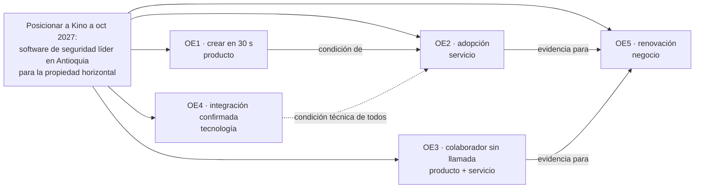
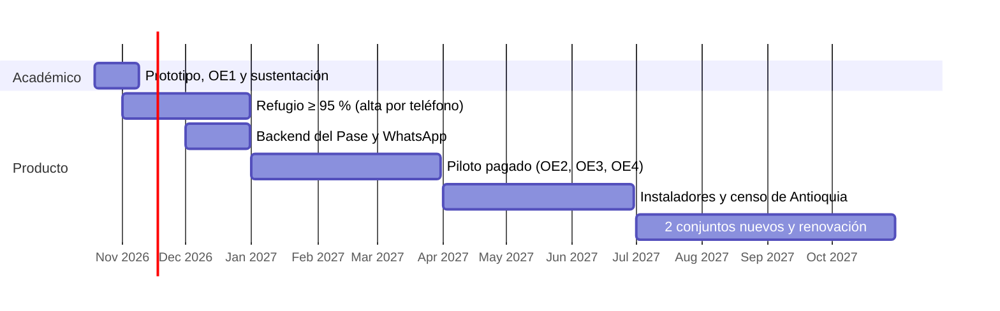

# Kino · Estrategia de servicio

Entrega 3 · 19 oct 2026 · Nicolás Ramírez y Alejandro Monsalve. Orden de las guías del curso: `fuentes/Plan_estrategico.pdf` e `Indicadores_2.pdf`. **[A]**: solo para la entrega académica. **[P]**: decisión de producto que sigue después de noviembre. La versión larga quedó en `_obsoleto/estrategia-larga.md`.

---

## 0. Kino en una tabla

| | |
|---|---|
| **Problema** | El residente sabe quién debe entrar y no puede decirlo; la administración tiene la autoridad y no sabe a quién espera. El sistema solo crea personas permanentes. *Observado, inspección 14–16 sep 2026.* |
| **Evidencia** | Refugio Campestre: 0 de 312 usuarios y 1 de 44 vehículos sincronizados; 711 errores `add_person` por el campo correo. *Observado (`MAESTRO-KINO.md` §3).* |
| **Tiempo** | **[A]** Sustentación: 9 nov 2026. **[P]** Piloto pagado: ene–mar 2027. **[P]** Horizonte del plan: oct 2027. |
| **Solución** | El **Pase**: autor, motivo, vigencia (horas, un día o meses) y modo (QR, placa o código). Lo otorga el residente dentro de las franjas de la administración; la visita no crea cuenta; Kino lo da de alta en HikCentral y solo lo muestra vigente si el lector confirma. |
| **Diferencia** | Neivor ya vende la autonomía del residente ([Neivor](https://landing.neivor.com/control-de-acceso-visitantes)). Kino se diferencia por tres cosas juntas: integración probada con el hardware instalado, Pase sin cuenta para la visita y autoridad del residente acotada por las franjas de la administración. |

### Qué cambia con Kino, frente por frente

| Frente | Qué cambia | Efecto en trazabilidad y HikCentral |
|---|---|---|
| Residente | App: código por WhatsApp, crear en 3 toques, extender y revocar con deshacer | Cada Pase tiene autor y hora |
| Visita | Pase vivo en el navegador, sin cuenta | No se crea un «Visitante» permanente |
| Portería | Pantalla con el porqué de cada lectura y botón para llamar | La llamada queda en la constancia y no abre la entrada |
| Administración | Franjas, constancia y estado de la sincronización con HikCentral | Ve quién autorizó a quién |
| Datos | Teléfono obligatorio y único; correo opcional | Quita la causa de los 711 errores |
| Integración | Persona temporal con «Válido desde / hasta»; Manuel confirmó vigencias hasta 2037 o 2099 (19 oct) | Una estadía de meses cabe en una sola alta (E3-6) |
| Operación | Carga de casas por cédula, capacitación de portería, señalética con QR | El registro se valida contra la cédula, sin aprobación de la administración |
| Legal | Ley 1581 de 2012 y SIC, Resolución 52185 de 2025 | La biometría nunca se exige |
| Negocio | Suscripción que paga la administración, único comprador | Sin dato de precio |

---

## Plan estratégico SOSTAC · las seis partes y dónde está cada una

| Letra | Parte del plan | Qué contiene | Sección |
|---|---|---|---|
| **S** | Situación (diagnóstico) | Problema, público objetivo (arquetipos), conclusiones del journey, insights y situación externa | §1 |
| **O** | Objetivos | Objetivo general, meta general y 5 objetivos SMART con sus preguntas orientadoras | §2 · §3 |
| **S** | Estrategia | Una o dos por objetivo, nombradas con sustantivo y ubicadas en un eje estratégico | §4 |
| **T** | Tácticas | Qué se hará, cómo, quién y cuándo | §5 |
| **A** | Acción | Plan de acción con hitos, responsables y entregables | §6 |
| **C** | Control | KPI con método GQM, etapas y tablero de seguimiento | §7 |

Fuera de SOSTAC, la guía pide **descripción de productos** (fichas, §10). El horizonte de empresa (§8 y §9) va como plan a 1 y a 5 años.

---

## 1. SOSTAC · S · Situación (diagnóstico)

### 1.1 SOSTAC · S · Descripción del problema (conclusiones del brief)
1. El conocimiento y la autoridad para decidir quién entra viven en actores distintos. *Brief v0.2 §02.*
2. El super administrador no aprueba ingresos: autorizar es dar de alta a un usuario permanente. *Observado.*
3. El residente ya abre la puerta al registrar una placa, aunque la pantalla diga que lo controla la administración. *Observado.*
4. El correo obligatorio molesta y además rompe la sincronización. *Observado, 711 errores.*

### 1.2 SOSTAC · S · Público objetivo (arquetipos) e insights
| Arquetipo | Quién es frente al sistema | Insight → qué hace la estrategia |
|---|---|---|
| A1 · Residente | El único que sabe a quién espera | Registra una placa y la deja «Permitido» sin saberlo → Pase con vigencia en lugar de una placa permanente |
| A2 · Colaborador | El ingreso más frecuente; 51,3 % de los contratos domésticos son por días ([Infobae, GEIH-DANE](https://www.infobae.com/colombia/2026/09/09/el-trabajo-domestico-cambia-de-ritmo-en-colombia-crecen-los-contratos-por-dias-y-la-informalidad-supera-el-87/)) | El correo obligatorio es el dato que más cuesta pedir y causa los 711 errores → teléfono en lugar de correo |
| A3 · Visita | Recibe una cuenta permanente por una visita de una tarde | La placa es la vía que menos datos pide → primer canal del Pase |
| A4 · Administración | Compra y opera; responde ante el consejo | Da de alta personas permanentes y no aprueba ningún ingreso → franjas y constancia como argumento de venta |

### 1.3 SOSTAC · S · Conclusiones del journey map (entrega 2)
Los cuatro recorridos fallan en la puerta: nadie puede fijar desde cuándo y hasta cuándo entra alguien. A los cuatro les falta un acceso con autor, motivo y vigencia: el Pase. Simetría invertida: el portero ve de los residentes lo que ellos no ven de sí mismos.

### 1.5 SOSTAC · S · Situación externa: mercado y competencia
| Dato | Fuente |
|---|---|
| 47,88 % de la vivienda urbana de Colombia está en propiedad horizontal (~6,7 M unidades); en Medellín, 61,7 % | Fedelonjas vía [Portafolio, 28 jun 2026](https://www.portafolio.co/mis-finanzas/vivienda/casi-la-mitad-de-viviendas-urbanas-en-colombia-estan-concentradas-en-conjuntos-cerrados-o-edificios-497094); [vivienda.com.co](https://vivienda.com.co/?p=3240) |
| Servicios de propiedad horizontal: +13,42 % anual a mayo de 2026, contra 5,84 % de inflación | Fedelonjas vía Portafolio |
| Bogotá: 69 % de los predios en propiedad horizontal (2025) | Catastro Distrital vía [Forbes Colombia](https://forbes.co/economia-y-finanzas/el-valor-de-los-inmuebles-de-bogota-supero-los-900-billones-con-un-alza-del-12-frente-al-2024-segun-el-catastro-distrital) |
| 74.521 copropiedades aseguradas en 2022, 63.388 residenciales (piso del universo) | Fasecolda vía [El Tiempo](https://www.eltiempo.com/economia/sector-financiero/alerta-hay-bajo-aseguramiento-de-copropiedades-en-colombia-estan-las-razones-808115) |
| Control de acceso global: US$10.000 M (2023) → US$18.300 M (2032), TACC 6,8 % | [IMARC](https://www.imarcgroup.com/report/es/access-control-market) |
| La biometría no se puede exigir para entrar a un conjunto | [SIC, Resolución 52185 de 2025](https://sedeelectronica.sic.gov.co/comunicado/la-superintendencia-de-industria-y-comercio-ordena-un-conjunto-residencial-habilitar-mecanismos-de-ingreso-que-no-impliquen-el-tratamiento) |
| WhatsApp cobra por plantilla desde jul 2025: ~US$0,0008 en Colombia (terceros; confirmar con Meta) | [Meta](https://developers.facebook.com/docs/whatsapp/pricing); [Leadsales](https://leadsales.io/blog/whatsapp-business-api-cuanto-cuesta/) |

| Competidor | Qué ofrece |
|---|---|
| Método manual (llamada, minuta, WhatsApp) | Gratis y conocido: el más fuerte. *Brief v0.2 §06* |
| Neivor | Autogestión de visitas por QR e integración; no dice si la visita necesita cuenta |
| ComunidadFeliz | Más de 6.900 conjuntos en diez países (brief v0.2, por reconfirmar) |
| Portea | App de portería de Medellín ([GetApp](https://www.getapp.co.uk/software/2104437/portea)) |
| ZKTeco | Hardware con software propio ([caso en Bogotá](https://www.zkteco.com/en/case/Access_Control_Solution_with_Biometrics_for_a_Residential_Complex_in_Colombia)) |

**Vacío:** no hay cifra oficial de copropiedades en Antioquia; la lleva la Cámara de Comercio de Medellín (Ley 675 de 2001). Conseguirla es la primera tarea de captación.

---

## 2. SOSTAC · O · Objetivo general (el qué) y meta general

**Objetivo general [P].** Posicionar a Kino, a octubre de 2027, como el software de seguridad líder en Antioquia para la propiedad horizontal: el aliado que reúne a residentes, visitas, colaboradores, portería y administración en la decisión de quién entra.

**Cómo se lee.** Qué es Kino (software de seguridad), dónde y con qué ambición (líder en Antioquia, a un año) y para qué (reunir a los cinco actores en la decisión de quién entra, que es la pregunta guía). Dirección de Nico (E3-10), pulida con el test de calidad de `investigacion-objetivo-general.md` §7. La diferencia frente a Neivor, ComunidadFeliz y ZKTeco va en las estrategias (§4).

**[A]** Demostrarlo en un prototipo donde los cuatro actores completan el recorrido del Pase.

**Meta a oct 2027 [P].** **1.º** en participación entre las copropiedades de Antioquia con lector compatible (KPI de §7; el denominador sale del censo del segundo trimestre de 2027) · **4** conjuntos con pago como piso (Villas, Refugio y 2 del Oriente antioqueño; sube si el censo muestra que no alcanza para liderar) · **95 %** de los Pases confirmados por el lector en menos de 60 s · **0** ingresos que exijan una persona permanente. *Supuesto:* los 2 conjuntos nuevos son meta del equipo.

---

## 3. SOSTAC · O · Objetivos específicos SMART · acción + métrica + usuario + contexto + tiempo

| # | Acción | Métrica | Usuario | Contexto | Tiempo | Punto de partida |
|---|---|---|---|---|---|---|
| **OE1** [A+P] | Crear y enviar un Pase de visita | ≤ 3 toques (reciente) y < 30 s KLM (nueva) | Residente (A1) | Prototipo, recorrido automático | Antes del 9 nov 2026 | **Medido 19 oct:** 3 toques · 8 s; nueva: 5 toques · 19,4 s |
| **OE2** [P] | Crear al menos un Pase | 60 % de las casas | Residentes (A1) | Piloto en Villas Campestres | 8 semanas, ene–feb 2027 | 0 Pases; 888 usuarios (casas por confirmar) |
| **OE3** [P] | Entrar con Pase y sin llamada | 80 % de sus ingresos | Colaboradores (A2) | Portería de Villas | Ene–mar 2027 | Se mide en la semana 1 con la minuta |
| **OE4** [P] | Confirmar el Pase en el lector y recuperar Refugio | 98 % en < 60 s; Refugio ≥ 95 % | Administración (A4) | HikCentral de Monte Sereno | Antes del 31 mar 2027 | Refugio 0/312 · 1/44 · 711 errores |
| **OE5** [P] | Renovar y firmar pilotos | Monte Sereno renueva + 2 conjuntos | Administración (compra) | Antioquia, desde el Oriente | Antes del 31 oct 2027 | 1 cliente |

### SOSTAC · O · SMART · preguntas orientadoras de la guía

| # | Específico · ¿por qué es importante? | ¿Quién está involucrado? | Alcanzable · ¿con qué recursos? | Medible · ¿cómo sabré que se logró? | Relevante · ¿es el momento? |
|---|---|---|---|---|---|
| OE1 | Si crear un Pase es más lento que llamar a portería, nadie lo usa | Equipo | Prototipo y recorrido automático `oe1.mjs` | ≤ 3 toques y < 30 s · **ya cumple** | Es la condición de OE2: se valida antes de construir |
| OE2 | La administración paga si los residentes crean Pases | Equipo y administración | Día de lanzamiento y línea por WhatsApp | 60 % de casas con ≥ 1 Pase | El piloto empieza en enero |
| OE3 | El colaborador es el ingreso más frecuente | Equipo, Manuel y portería | Pase recurrente; la minuta para medir | 80 % de sus ingresos con Pase | 51,3 % del trabajo doméstico ya es por días |
| OE4 | Sin integración, el lector no conoce el Pase | Equipo con Manuel | OpenAPI de HikCentral; alta con teléfono | 98 % en < 60 s; Refugio ≥ 95 % | Refugio tiene hardware pagado y 0/312 sincronizados |
| OE5 | Sin contratos, Kino se acaba con la entrega de noviembre | Equipo e instaladores | Caso con KPI reales; ficha comercial | Renovación y 2 contratos | La entrega académica termina en noviembre |

A tiempo: la columna **Tiempo** de la tabla anterior (¿qué puedo hacer hoy, en seis semanas, en seis meses?).

### SOSTAC · O · Conexión de los objetivos con el plan general

---

## 4. SOSTAC · S · Estrategias (el cómo), con su eje estratégico

| Objetivo | Estrategia | Cómo | Eje del curso |
|---|---|---|---|
| OE1 | **Simplificación** | El Pase en una hoja; la persona reciente a un toque | 1 · Interactividad |
| OE1 | **Medición** | Toques y KLM en cada versión; inspección con perfiles | 4 · Soporte |
| OE2 | **Acompañamiento** | Lanzamiento en sitio y por WhatsApp | 4 · Soporte |
| OE2 | **Diversificación** | QR, placa, código e imagen por WhatsApp | 2 · Omnicanalidad |
| OE3 | **Recurrencia** | Un Pase con días y franja que se crea una vez | 3 · Automatización |
| OE4 | **Integración** | Alta con teléfono, confirmación del lector, monitoreo | 3 · Automatización |
| OE4 | **Transparencia** | Nunca vigente lo que el lector no confirmó | 3 · Automatización |
| OE5 | **Penetración** | Por quien instaló el hardware Hikvision | 2 · Omnicanalidad |
| OE5 | **Fidelización** | Constancia y reporte semanal a la administración | 3 · Automatización |

### SOSTAC · S · Ejes estratégicos del curso

| Eje | Qué dice la guía | Estrategias de Kino |
|---|---|---|
| 1 · Interactividad y personalización | Lo que se ve se adapta a los intereses de quien lo usa, con opciones interactivas | Simplificación |
| 2 · Omnicanalidad y accesibilidad | Canales físicos y digitales, sin limitaciones de acceso | Diversificación · Penetración |
| 3 · Automatización y gestión | Sistemas digitales que organizan el recorrido y agilizan el acceso | Recurrencia · Integración · Transparencia · Fidelización |
| 4 · Soporte y acompañamiento | Orientación y ayuda cuando alguien se traba | Medición · Acompañamiento |

---

## 5. SOSTAC · T · Tácticas (qué · cómo · quién · cuándo)

| Estrategia | Qué | Cómo | Quién | Cuándo |
|---|---|---|---|---|
| Simplificación | Volver a invitar | 4 personas recientes abren la hoja ya llena | Equipo | Oct 2026 ✔ |
| Simplificación | Vigencia a tu medida | Unas horas, un día o «Se queda» (3 días a 3 meses) | Equipo | Oct 2026 ✔ |
| Medición | Toques y KLM | `prototipo/pruebas/oe1.mjs` falla si pasa la meta | Equipo | 19 oct 2026 ✔ |
| Acompañamiento | Día de lanzamiento | Puesto en la entrada; primer Pase con cada residente | Equipo y administración | Semana 1, ene 2027 |
| Acompañamiento | Línea de ayuda | WhatsApp de Kino con un responsable por turno | Equipo | Desde el piloto |
| Diversificación | Pase por imagen y enlace | Plantilla de utilidad de WhatsApp Business | Equipo | Dic 2026 |
| Recurrencia | Pase de colaborador | Persona temporal con horario, o renovación diaria | Equipo con Manuel | Dic 2026 – ene 2027 |
| Integración | Alta con teléfono | Quitar el correo y reintentar las 711 | Equipo con Manuel | Nov – dic 2026 |
| Integración | Monitor de sincronización | Alerta si baja de 95 % | Equipo | Ene 2027 |
| Transparencia | Estado honesto | Vigente solo con respuesta del lector | Equipo | Prototipo ✔ · producción ene 2027 |
| Penetración | Alianza con instaladores | Ficha comercial para el Valle de Aburrá y el Oriente | Equipo | Abr – jun 2027 |
| Fidelización | Reporte semanal | Lunes: entradas, rechazos con motivo y estado del lector | Equipo | Feb 2027 |

---

## 6. SOSTAC · A · Plan de acción (hitos, responsables y entregables)

| Periodo | Hito | Responsable | Entregable |
|---|---|---|---|
| 19 oct – 9 nov 2026 [A] | Prototipo, OE1 y sustentación | Nicolás y Alejandro | Deck, Biblia, prototipo |
| Nov – dic 2026 | Alta temporal por OpenAPI; arreglar Refugio | Equipo con Manuel | Refugio ≥ 95 % |
| Dic 2026 | Backend del Pase y WhatsApp Business | Equipo | Beta |
| Ene – mar 2027 | Piloto pagado en Villas y Refugio | Equipo con la administración | OE2, OE3, OE4 medidos |
| Abr – jun 2027 | Ficha comercial, instaladores y censo de copropiedades de Antioquia con lector | Equipo | 10 conjuntos contactados; denominador de la participación |
| Jul – oct 2027 | 2 conjuntos nuevos; renovación; participación medida | Equipo | Meta general |

---

## 7. SOSTAC · C · Control: KPI con método GQM

**Paso a paso de la guía de indicadores:** 1) determinar el objetivo (G), 2) definir una variable (la pregunta Q y su métrica M) y 3) relacionarla con la meta. Un KPI mide el rendimiento de un proceso, se expresa como un valor frente a una meta fijada, siempre está atado a un objetivo y se revisa con periodicidad (columna «Cada»).

Objetivo → pregunta → métrica, con su etapa (captación, comportamiento, conversión, satisfacción, confianza o compromiso). **★** marca el KPI principal de cada objetivo (el que va en el deck y la Biblia).

| Obj. | Pregunta | KPI | Fórmula | Meta | Etapa | Cada |
|---|---|---|---|---|---|---|
| OE1 ★ | ¿Crear un Pase es más rápido que llamar? | Tiempo para crear | KLM: 1,35 s decisión, 1,1 s desplazamiento, 0,2 s toque, 0,28 s carácter + espera | < 30 s | Comportamiento | Versión; semana en piloto |
| OE1 | ¿Cuánto cuesta volver a invitar? | Toques con visita reciente | Toques hasta «Enviar por WhatsApp» | ≤ 3 | Comportamiento | Versión |
| OE2 | ¿Qué tan fácil de usar lo encuentran los residentes? | SUS | 10 ítems | ≥ 80 | Satisfacción | Semana 6 |
| OE2 ★ | ¿Cuántas casas crean Pases? | Activación de casas | Casas con ≥ 1 Pase ÷ casas registradas | ≥ 60 % a 8 semanas | Conversión | Semana |
| OE2 | ¿Vuelven a usarlo? | Retención | Crean Pase en 2 semanas distintas ÷ activados | ≥ 50 % | Compromiso | Mes |
| OE3 ★ | ¿El colaborador entra sin llamada? | Ingresos con Pase | Ingresos por lector ÷ ingresos en minuta | ≥ 80 % | Comportamiento | Semana |
| OE4 ★ | ¿El lector recibe el Pase en menos de un minuto? | Confirmación del lector | Confirmados en < 60 s ÷ creados | ≥ 98 % | Confianza | Día |
| OE4 | ¿Cuántos usuarios de Refugio están sincronizados? | Sincronización | Usuarios sincronizados ÷ usuarios | ≥ 95 % | Confianza | Día |
| OE4 | ¿La app muestra vigente un Pase que el lector rechaza? | Discrepancia app–puerta | Vigentes que el lector rechaza ÷ lecturas | ≤ 0,5 % | Confianza | Semana |
| OE5 | ¿La administración recomendaría Kino a otro conjunto? | NPS de la administración | Promotores − detractores | ≥ 30 | Satisfacción | Trimestre |
| OE5 ★ | ¿Cuántos conjuntos pagan? | Conjuntos con pago | Contratos | 4 a oct 2027 | Conversión | Mes |
| OE5 | ¿Los rechazos tienen explicación? | Rechazos con motivo | Con motivo ÷ rechazos | 100 % | Confianza | Semana |
| General | ¿Kino lidera en Antioquia? | Participación | Conjuntos con Kino ÷ copropiedades de Antioquia con lector compatible | 1.º: mayor que la de cualquier competidor | Conversión | Semestre |

### SOSTAC · C · Etapas del plan y el KPI que cubre cada una

| Etapa | KPI |
|---|---|
| Captación | Costo de adquisición por conjunto (§9.2) |
| Comportamiento | Tiempo para crear (OE1) · toques con visita reciente (OE1) · ingresos con Pase (OE3) |
| Conversión | Activación de casas (OE2) · conjuntos con pago (OE5) · participación en Antioquia (objetivo general) |
| Satisfacción | SUS (OE2) · NPS de la administración (OE5) |
| Confianza | Confirmación del lector · sincronización · discrepancia app–puerta (OE4) · rechazos con motivo (OE5) |
| Compromiso | Retención de residentes (OE2) |

**«Ingresos en minuta» (OE3).** La minuta es el cuaderno donde portería anota a mano cada ingreso. El KPI divide los ingresos de colaboradores que abrió el lector con un Pase entre todos los ingresos de colaboradores anotados. Ejemplo: 80 de 100 en la semana = 80 %, la meta.

### SOSTAC · C · Tablero de seguimiento
Un panel por objetivo con el último dato, su serie y la meta como línea punteada (deck, lámina 16). OE1 se alimenta de `prototipo/pruebas/oe1.mjs`; en el piloto, OE2 y OE3 de la base de Kino y la minuta, OE4 de HikCentral y OE5 de los contratos.

*Fuentes de medición:* `oe1.mjs`, base de Kino, HikCentral, minuta de portería y encuestas. Las metas de OE2, OE3 y OE5 son supuestos y se recalibran en la semana 1 del piloto.

---

## 8. A 1 año (oct 2027) [P]

| Frente | Estado |
|---|---|
| Producto | Residente, Pase vivo, Portería y Administración en producción, conectados a HikCentral |
| Clientes | 4 conjuntos con pago como piso; primero en participación en Antioquia |
| Prueba | Un caso con KPI reales (OE2 a OE4) para vender |
| Empresa | SAS con facturación electrónica y bases registradas ante la SIC |
| Equipo | Nicolás y Alejandro, más un integrador aliado |

---

## 9. Kino como empresa, 3 a 5 años [P]

**Visión.** Kino empieza por quién entra y crece hacia los demás problemas de seguridad de la propiedad horizontal que descubra con sus clientes, sobre el hardware que cada conjunto ya tiene. El objetivo general del plan (§2) cubre el primer año y el primer problema; la visión cubre el portafolio.

### 9.1 Objetivos de empresa
| # | Objetivo | Año |
|---|---|---|
| E1 | 40 conjuntos con pago en Antioquia | 2028 |
| E2 | Conectores para un segundo y un tercer fabricante (ZKTeco, Dahua) | 2028–2029 |
| E3 | 250 conjuntos en Antioquia y Bogotá | 2030 |
| E4 | Punto de equilibrio con ingresos recurrentes | 2029 |
| E5 | Pase para personal del conjunto y contratistas (A-08) | 2029 |
| E6 | Segundo servicio de seguridad, salido de un problema validado con las administraciones clientes (por descubrir; no está en el diagnóstico) | 2028–2029 |

*Supuesto:* E1 y E3 son ambición del equipo; se calibran con cuántas copropiedades tienen hardware Hikvision y con el precio que acepte una administración.

### 9.2 KPI de empresa
| KPI | Fórmula | Etapa |
|---|---|---|
| Ingreso recurrente mensual (MRR) | Suma de suscripciones activas | Conversión |
| Rotación de conjuntos | Cancelan ÷ conjuntos al inicio | Compromiso |
| Costo de adquisición | Gasto comercial ÷ conjuntos nuevos | Captación |
| Tiempo de implementación | Días de la firma al primer Pase confirmado | Comportamiento |
| Cobertura de fabricantes | Conectores en producción | Confianza |
| Pases confirmados | Igual que OE4, a escala | Confianza |

### 9.3 SOSTAC de empresa
| | |
|---|---|
| **S** | 47,88 % de la vivienda urbana en propiedad horizontal; servicios de propiedad horizontal +13,42 % anual (§1.5). Neivor y ComunidadFeliz venden software sin hardware; ZKTeco, hardware con software propio. Nadie autoriza ingresos sobre el lector que el conjunto ya tiene |
| **O** | E1 a E6 |
| **S** | **Replicación** con instaladores (E1) · **Independencia** del fabricante (E2) · **Expansión** a Bogotá (E3) · **Eficiencia**: implementación en < 10 días (E4) · **Ampliación** del Pase a quien entra por trabajo (E5) · **Portafolio**: descubrir y validar con los clientes el siguiente problema de seguridad (E6) |
| **T** | Programa de instaladores con comisión; kit de implementación; conector ZKTeco con un cliente ancla; ficha para consejos; plantilla de reglamento con franjas |
| **A** | 2027: Monte Sereno + 2 · 2028: 40 conjuntos y segundo conector · 2029: equilibrio · 2030: Bogotá |
| **C** | KPI de 9.2 cada mes; NPS de la administración cada trimestre |

### 9.4 Lista de mercado
| Producto o servicio | Estrategia | Costo | Estado |
|---|---|---|---|
| WhatsApp Business Platform vía proveedor (BSP) | Diversificación, Acompañamiento | ~US$0,0008 por mensaje | Confirmar con Meta |
| HikCentral Professional OpenAPI y socios Hikvision | Integración | Por cotizar | Pendiente con Manuel |
| Conector ZKTeco o Dahua | Independencia | Por cotizar | 2028 |
| Lector QR compatible donde solo hay LPR | Diversificación | Por cotizar | Sin dato |
| Tableta Android de portería en kiosco | Transparencia | Por cotizar | Sin dato |
| Nube en Latinoamérica, monitoreo y respaldo | Integración | Por cotizar | Sin dato |
| Facturación electrónica (DIAN) y pasarela B2B | Fidelización | Por cotizar | Obligatorio |
| Registro de bases ante la SIC y política (Ley 1581) | Integración, Transparencia | Asesoría por cotizar | Obligatorio |
| Apple Developer y Google Wallet (I-18) | Diversificación | Por confirmar | 2027 |
| Póliza de responsabilidad civil y ciberseguridad | Fidelización | Por cotizar | 2028 |
| Kit de implementación (señalética, guía, capacitación) | Acompañamiento, Penetración | Producción propia | Sin dato |
| CRM y página de producto | Penetración | Por cotizar | Sin dato |

---

## 10. Descripción de productos · fichas de producto (insumo para mapas y prototipos)

| Ficha | Propósito | Elementos clave | Tecnología | Escenario | Sirve a |
|---|---|---|---|---|---|
| **F1 · Kino Residente** | Otorgar, acotar y revocar Pases | Código por WhatsApp (I-01), Pase vivo (I-02), volver a invitar (I-03), hoja (I-04), vigencia (I-05), revocar con deshacer (I-13), extender (I-14), aviso (I-11) | PWA en TypeScript, `@kino/motion`, push | A las 2 p. m. Carolina toca «Andrés» y «Crear Pase»; a las 3:04 le llega «Andrés entró» | OE1, OE2, OE3 |
| **F2 · Pase vivo** | Que la visita entre sin cuenta | Enlace (I-09); QR, placa o código; cuenta regresiva | Web estática con datos en vivo; imagen generada en el servidor | Andrés llega en carro y el lector lee su placa; si no, acerca el QR | OE2 |
| **F3 · Kino Portería** | Ver por qué entró o no cada persona | Lectura legible a 3 m (I-10), rechazo con motivo (I-12), llamar sin abrir, bitácora | Tableta Android en kiosco; eventos de HikCentral | Laura llega 10 min tarde; el portero llama, Carolina extiende y entra | OE3, OE4 |
| **F4 · Kino Administración** | Fijar las franjas y revisar la sincronización con HikCentral | Franjas con vista previa (I-15), reintento de sincronización (I-16), resumen | Web, API de Kino, correo semanal | El consejo pide cerrar a las 9 p. m.; mueve la franja y ve qué Pase quedaría fuera | OE4, OE5 |
| **F5 · Conector HikCentral** | Dar de alta el Pase en el lector | Estado honesto (I-07); cola de reintentos | HikCentral Professional OpenAPI, persona temporal hasta 2037 o 2099 | Se crea un Pase y el lector responde en 3 s; si falla, queda Sin confirmar con la causa | OE4 |
| **F6 · Kit de implementación** | Un conjunto nuevo operando en < 10 días | Carga por cédula, capacitación de 45 min, señalética con QR, lanzamiento | Servicio | Lunes firma, martes carga, jueves capacitación de tres turnos, sábado lanzamiento | OE2, E4 |

---

## 11. Pendientes por verificar

1. Probar en el piloto el alta temporal por OpenAPI (Manuel ya confirmó la vigencia hasta 2037 o 2099).
2. Contar las casas de Villas Campestres: 888 son usuarios, no casas.
3. Fijar el precio de la suscripción con la administración.
4. Resolver la diferencia de 893 contra 1.200 usuarios (maestro §7).
5. Contar las copropiedades de Antioquia con lector compatible y su proveedor actual: es el denominador de «líder» en el objetivo general.
