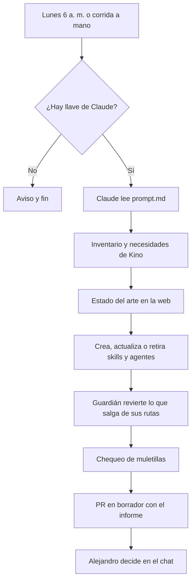

# Curador de agentes y skills

Agente que vive en GitHub. Cada lunes a las 6 a. m. (Colombia) revisa los agentes, las skills y los hooks de Kino, busca lo nuevo en IA y abre un PR en borrador con sus cambios y un informe. Nunca integra: Alejandro aprueba desde el chat (D-008). Lo crea D-013.

## Cómo funciona

| Archivo | Qué es | Quién lo cambia |
|---|---|---|
| [`prompt.md`](prompt.md) | Instrucciones del curador: límites, pasos y formato del informe | El curador lo propone; Alejandro aprueba |
| [`estado.md`](estado.md) | Memoria entre semanas: inventario, pendientes y fuentes | El curador, cada semana |
| `informes/AAAA-MM-DD.md` | Informe de cada semana; es el cuerpo del PR | El curador |
| [`limitar-cambios.sh`](limitar-cambios.sh) | Guardián: revierte lo que el curador toque fuera de sus rutas y toda aprobación en `decisiones.md` | Solo una persona, en un PR propio |
| [`../../.github/workflows/curador-semanal.yml`](../../.github/workflows/curador-semanal.yml) | La Action que lo corre | Solo una persona, en un PR propio |

## Qué puede y qué no puede hacer

| Puede | No puede |
|---|---|
| Crear, cambiar y borrar skills (`.claude/skills/`) y agentes (`.claude/agents/`) | Integrar, aprobar decisiones, cerrar PR o issues |
| Cambiar hooks (`.claude/settings.json`), `AGENTS.md`, `CLAUDE.md` y `herramientas/prompt-grok.md` | Tocar `pre-kino/`, `.github/`, `kino/canon/proyecto.md`, código, marca o producto |
| Agregar entradas PROPUESTA en `decisiones.md` | Borrar o aprobar entradas de `decisiones.md` |
| Cambiar sus propias instrucciones (`prompt.md`) | Cambiar su guardián ni su Action |
| Leer la web, los PR y los issues | Correr comandos fuera de la lista de la Action |

Si el concepto de agente o skill cambia, el curador escribe una PROPUESTA con un plan por etapas y deja solo el primer paso en el PR. Lo que pida cambiar la Action o el guardián va en el informe como recomendación para una persona.

## Configuración (Alejandro, una sola vez)

| Paso | Dónde | Qué |
|---|---|---|
| 1 | Terminal de tu computador, con Claude Code instalado | Corre `claude setup-token`. Inicia sesión con la cuenta de Claude Pro. Copia la llave que muestra |
| 2 | GitHub, repositorio, Settings > Secrets and variables > Actions > New repository secret | Nombre `CLAUDE_CODE_OAUTH_TOKEN`, valor: la llave del paso 1 |
| 3 | GitHub, Settings > Actions > General > Workflow permissions | Activa «Allow GitHub Actions to create and approve pull requests» (el PR #29 pide lo mismo) |
| 4 (opcional) | GitHub, Settings > Developer settings > Fine-grained tokens | Llave con acceso solo a `Amonsalvem/kino`: *Contents* y *Pull requests* en lectura y escritura. Guárdala como secreto `CURADOR_TOKEN` |
| 5 | GitHub, Actions > Curador semanal > Run workflow | Primera corrida de prueba |

**Por qué el paso 4.** GitHub no corre otras Actions sobre un PR abierto con la llave propia de la Action. Sin `CURADOR_TOKEN`, el PR del curador no muestra «Revisar texto» ni el resumen hasta que alguien suba un commit. El curador corre igual el chequeo de muletillas antes de abrir el PR y lo anota en el informe.

**Alternativa al paso 1.** Una llave de la API de Anthropic (console.anthropic.com > API keys), guardada como `ANTHROPIC_API_KEY`. Se paga por uso, aparte de Claude Pro. Usa una sola de las dos.

## Costo y límites

- Con `CLAUDE_CODE_OAUTH_TOKEN`, cada corrida gasta del mismo límite de uso de la cuenta Claude Pro. Una corrida semanal de hasta 80 turnos puede consumir una parte visible del límite de ese día (sin medir todavía; se mide en la primera corrida).
- La Action tiene un tope de 60 minutos y 80 turnos.
- Si no hay llave, la Action termina con un aviso y no hace nada.
